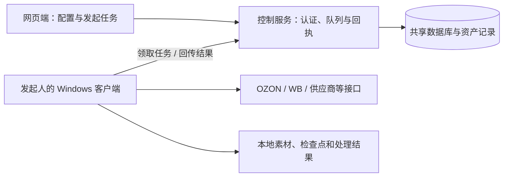

# Russia Crossborder ERP

面向俄罗斯跨境电商业务的 ERP，整合产品与图片资产、OZON/Wildberries（WB）上架、POD 订单、供应商采购、广告分析及任务协作。仓库包含 **Python 后端、Vue 网页端和 Windows 桌面执行客户端**，同时包含 Amazon 美国站上架相关模块。

> 这是基于 **2026-10-20 / `48904b3`** 整理的公开源码快照，已包含手工 POD 订单和订单同步范围功能。生产地址与存储桶名称已替换为示例值；仓库不提供店铺账号、业务数据或可直接使用的生产环境。功能代码存在不等于已在你的账号、网络和平台权限下完成验证。

## 目录

- [功能范围](#功能范围)
- [系统架构与运行模式](#系统架构与运行模式)
- [技术栈与目录结构](#技术栈与目录结构)
- [本地快速开始](#本地快速开始)
- [配置说明](#配置说明)
- [服务器部署](#服务器部署)
- [Windows 桌面客户端](#windows-桌面客户端)
- [订单操作示例](#订单操作示例)
- [开发与验证](#开发与验证)
- [常见问题](#常见问题)
- [公开快照与更新方式](#公开快照与更新方式)

## 功能范围

| 模块 | 源码包含的主要能力 | 使用前需要准备 |
| --- | --- | --- |
| 产品与资产 | 产品库、SKU/规格、供应商来源、图片资产及导入 | 自有商品资料、素材和对应来源配置 |
| OZON | 商品准备、文案与图片处理、上架及库存/促销相关流程 | 店铺 Client ID、API Key、类目与商品资料 |
| WB | 商品卡、Excel/API 上架、店铺同步、库存与价格任务 | 对应权限的 WB Token、仓库和商品资料 |
| POD | 设计图入库、图片合成、AI 生图/超分、供应商货盘 | 产品模板、供应商连接；AI/超分另需相应服务或运行库 |
| POD 订单 | 平台同步、手工建单、SKU 匹配、待采购列表、采购/物流跟踪 | 店铺、产品规格；采购和物流操作另需供应商配置 |
| 广告 | OZON 广告数据同步、分析、回测、预览与执行记录 | Seller/Performance API 权限及业务参数 |
| Amazon | 美国站商品准备、变体分组、验证与提交相关流程 | Amazon 账号连接、授权和商品属性 |
| 任务与协作 | 账号、执行电脑、任务步骤、回执、失败处理和审计 | 共享服务器、个人账号及兼容客户端 |

平台费用、供应商服务和 AI 服务不包含在代码仓库中。平台接口及限流策略可能变化，应在自己的测试环境验证后再处理真实业务。

## 系统架构与运行模式



共享部署中，服务器负责认证、任务协调和共享数据；个人业务任务在发起人的电脑执行。电脑离线时任务等待原电脑恢复，不自动转派。网页显示任务已创建，只代表已进入队列，应继续核对任务步骤和最终回执。

| `ERP_RUNTIME_MODE` | 用途 | 启动方式 |
| --- | --- | --- |
| `local` | 单机运行网页、API 和本地队列执行器 | `python -m erp.launcher` |
| `server` | 云端网页、API、账号和任务协调 | 本文 Docker Compose 流程 |
| `worker` | 独立通用 Worker 协议入口 | `python -m erp.remote_worker`；需单独配置身份与能力 |

**通用 Worker 与 Windows 个人客户端是两套入口。** 普通团队成员使用下面的桌面客户端流程；不要仅设置 `ERP_RUNTIME_MODE=worker` 就认为所有个人业务任务已经接通。

## 技术栈与目录结构

- 后端：Python 3.12+、FastAPI、Pydantic、SQLAlchemy、Alembic。
- 前端：Vue 3、TypeScript、Element Plus、Vite；依赖见 [package.json](frontend/package.json)。
- 数据：本地默认 SQLite；共享部署示例使用 PostgreSQL 16。
- 客户端：Windows、Python 3.12+、Tk；本地会话与检查点使用 Windows 加密能力。
- 构建：Node.js 与 npm；本快照前端已在 Node.js 24 环境构建验证，安装时使用锁文件。

```text
backend/erp/          API、业务模块、任务调度和平台集成
backend/alembic/      数据库迁移
frontend/            网页源码、静态资源与依赖锁文件
client/desktop/      Windows 个人执行客户端
browser-extensions/ 浏览器辅助扩展源码
scripts/             通用安装、构建、导入和接口索引工具
deploy/             Dockerfile、Compose 与配置模板
tests/              自动化测试
docs/codex/         API 索引与 OpenAPI 快照
tools/              外部图片处理运行库的准备说明
```

接口查询入口：[全量接口索引](docs/codex/全量接口索引.md) · [OpenAPI 快照](docs/codex/openapi.json)。

## 本地快速开始

以下以 **Windows PowerShell** 为例，使用一个全新的开发目录。需要先安装 Git、Python 3.12+（包含 Tk）及 Node.js/npm。

### 1. 获取代码并安装依赖

```powershell
git clone https://github.com/wxz2551664230-alt/russia-crossborder-erp-public.git
cd russia-crossborder-erp-public
py -3.12 -m venv .venv
.\.venv\Scripts\python.exe -m pip install -e ".[dev]"
Copy-Item .env.example .env
npm ci --prefix frontend
npm run build --prefix frontend
```

若安装的是更新版本 Python，可用 `py -m venv .venv`。已有 `.env` 时保留自己的配置，不要覆盖。

### 2. 检查本地配置并初始化数据库

保留 `.env` 中的以下本地设置；保持数据目录与项目目录独立于其他正在运行的 ERP：

```dotenv
ERP_RUNTIME_MODE=local
ERP_ENVIRONMENT=development
ERP_HOST=127.0.0.1
ERP_PORT=8788
ERP_DATA_DIR=./data
ERP_DATABASE_URL=
ERP_MULTIUSER_ENABLED=false
```

```powershell
.\.venv\Scripts\python.exe -m erp.migrate
```

SQLite 模式下，迁移工具会在升级前备份已存在的相关数据库。数据库和加密密钥应一起保管；Windows DPAPI 保护的密钥不能直接换到其他 Windows 用户下使用。

### 3. 启动完整本地应用

```powershell
.\.venv\Scripts\python.exe -m erp.launcher
```

本地启动器会启动 API 与本地队列执行器，并打开带本地认证入口的浏览器页面。默认地址为 `http://127.0.0.1:8788`。关闭启动器控制台会停止本次启动的服务。

只需调试 API 时可以单独运行下列命令，但它**不会启动本地业务队列执行器**，也不替代启动器的本地认证流程：

```powershell
.\.venv\Scripts\python.exe -m uvicorn erp.main:app --host 127.0.0.1 --port 8788
```

## 配置说明

完整字段以 [.env.example](.env.example)、[部署环境模板](deploy/.env.example) 和 [Settings 定义](backend/erp/core/config.py) 为准。

| 配置项 | 用途与设置方式 |
| --- | --- |
| `ERP_RUNTIME_MODE` | 选择 `local` / `server` / `worker` |
| `ERP_DATA_DIR` | 本地数据、日志与运行文件目录 |
| `ERP_DATABASE_URL` | 本地可留空使用 SQLite；共享部署使用 PostgreSQL 连接串 |
| `ERP_SECRET_KEY` | Fernet 主密钥；Linux/服务器必须提供并长期保存，不能随意重生成 |
| `ERP_ACCESS_TOKEN` | 服务端操作员认证凭据；与 Worker 凭据分开生成 |
| `ERP_MULTIUSER_ENABLED` | 共享账号登录开关；配合管理员初始化使用 |
| `ERP_SESSION_COOKIE_SECURE` | HTTPS 部署设为 `true`；HTTP 本地调试不能照搬 HTTPS 设置 |
| `ERP_ASSET_REMOTE_ALLOWED_HOSTS` | 允许读取资产的准确 HTTPS 主机名，JSON 数组，不填通配符 |
| `ERP_ASSET_ROOTS` | 额外可信本地素材目录，JSON 数组 |
| `ERP_CONTROL_PLANE_URL` | 通用 Worker 连接的控制服务 URL |
| `ERP_WORKER_ID` / `ERP_WORKER_TOKEN` | 通用 Worker 身份与凭据，不替代个人客户端登录 |
| `ERP_WORKER_REQUIRE_DEVICE_IDENTITY` / `ERP_WORKER_TOKEN_HASHES` | 通用 Worker 身份映射及校验，见部署模板 |

店铺 API、供应商和 AI 连接由应用配置管理，不应写进源码。`erp.example.com`、示例存储桶及测试域名需要替换为自己的服务；`.env` 和运行数据不提交到 Git。

## 服务器部署

下面是新环境的基础部署路径：需要 Docker Compose、Python 3（用于生成初始配置）、前端构建环境，以及你自己的域名和 HTTPS 反向代理。**当前仓库没有附带已经配置好的公网入口。**

### 1. 构建前端并创建独立配置

在 Linux 服务器的仓库根目录执行：

```bash
npm ci --prefix frontend
npm run build --prefix frontend
```

下面的脚本从模板生成 `deploy/.env`，直接写入随机凭据，不打印其内容；如果文件已存在会停止：

```bash
python3 - <<'PY'
from pathlib import Path
import base64
import secrets

path = Path("deploy/.env")
values = {
    "POSTGRES_PASSWORD": secrets.token_hex(32),
    "ERP_SECRET_KEY": base64.urlsafe_b64encode(secrets.token_bytes(32)).decode(),
    "ERP_WORKER_TOKEN": secrets.token_hex(32),
    "ERP_ACCESS_TOKEN": secrets.token_hex(32),
}
lines = []
for line in Path("deploy/.env.example").read_text().splitlines():
    key = line.partition("=")[0]
    lines.append(f"{key}={values[key]}" if key in values else line)
with path.open("x", encoding="utf-8") as stream:
    stream.write("\n".join(lines) + "\n")
path.chmod(0o600)
PY
```

随后检查 `deploy/.env` 中的账号模式、HTTPS Cookie、资产域名和 Worker 身份配置。空的 Worker 身份映射不会自动允许通用 Worker 接入。

### 2. 初始化数据库与管理员

```bash
docker compose -f deploy/compose.yaml --env-file deploy/.env build
docker compose -f deploy/compose.yaml --env-file deploy/.env up -d database
docker compose -f deploy/compose.yaml --env-file deploy/.env run --rm api python -m alembic upgrade head
docker compose -f deploy/compose.yaml --env-file deploy/.env run --rm api python -m erp.bootstrap_admin --username admin --display-name Administrator
docker compose -f deploy/compose.yaml --env-file deploy/.env up -d api
```

管理员命令会交互式读取密码，至少 10 个字符，没有默认共享密码。已有环境升级前，应另行备份 PostgreSQL、应用数据卷和主密钥；上述首次部署命令不等同于完整的备份/恢复方案。

### 3. 配置访问并核对服务

Compose 默认仅将 API 暴露到宿主机 `127.0.0.1:8789`。将自己的 HTTPS 域名反向代理到该地址，并正确传递 Host 与转发协议等请求头；不要把示例域名当作可用服务器。

```bash
curl -fsS http://127.0.0.1:8789/health
docker compose -f deploy/compose.yaml --env-file deploy/.env logs --tail=100 api
```

`/health` 成功只能证明 API 可响应；还需通过浏览器登录、客户端连接和任务回执验证业务流程。服务端的重型业务执行应保持在个人电脑，不在此部署额外的平台业务执行器。

仓库还保留了 [install.sh](deploy/install.sh)，但它包含固定安装路径，且不涵盖这里完整的账号与 HTTPS 配置。首次部署建议使用上述显式步骤。

## Windows 桌面客户端

### 构建与安装

1. 按 [外部运行库说明](tools/realesrgan-ncnn-vulkan/README.md) 准备 Real-ESRGAN 的程序、运行库和模型。它们未放入公开仓库；**当前完整客户端打包脚本会读取这些文件**，缺失时不能直接完成打包。
2. 在源码根目录执行：

   ```powershell
   .\.venv\Scripts\python.exe scripts/build_desktop_client.py
   ```

3. 将生成的 `outputs/erp-desktop-<version>.zip` 解压到目标 Windows 电脑。
4. 确认该电脑安装了 Python 3.12+ 和 Tk，再运行包内 `install.cmd`。不要直接在源码目录运行安装脚本，安装需要构建生成的 `manifest.json`。
5. 打开客户端，填写自己的服务器地址并登录；在网页“我的执行电脑”选择本机，再发起任务。

### 任务与数据

客户端运行期间负责领取属于当前用户、本机的任务并回传结果。本地会话和加密检查点不应上传到仓库。修改过订单协议后，应从对应版本源码重建客户端；仅刷新网页不能更新其他电脑的执行代码。

## 订单操作示例

### 同步近 3 天订单

1. 登录并选择当前执行电脑，进入“POD 订单”。
2. 选择一个 OZON 或 WB 店铺，点击“同步所选店铺订单”。
3. 选择 **3 天**，需要时改为 1/7/15/30 天或自定义开始、结束时间。
4. 图片同步默认关闭以减少请求；需要补商品图时再勾选。
5. 点击“开始同步”，进入任务中心查看实际步骤和完成回执，完成后刷新订单列表。

筛选依据为**订单创建时间，不是更新时间**。快捷选项是滚动天数，界面按当前电脑时区显示，任务保存带时区的固定起止时间，重试不扩大窗口。自定义范围 OZON 最多 90 天，WB 最多 30 天；更早创建但尚未处理的订单不包含在本次小范围同步中。

### 按平台订单号同步

| 平台 | 输入内容 | 请求方式 |
| --- | --- | --- |
| OZON | 发货单号 `posting_number` | 直接读取指定发货单，不扫描历史列表；此模式不按时间范围限制 |
| WB | 数字组装任务 ID | 在所选时间范围内查找；全部找到后结束分页，仅查询命中订单的状态 |

支持换行或逗号分隔，最多 100 个输入，重复编号会去重。WB 缺少编号时会明确报错，不把部分查找结果当作全部成功。

### 创建手工订单

点击“创建手工订单”，选择启用的 OZON/WB 店铺，填写订单号，从产品库选择规格并填写数量。无需收件信息，保存后进入待创建采购列表，后续沿用采购流程。同店铺重复订单不会静默覆盖已有订单。

**同步和手工建单不等于已向供应商采购或已发货。** 后续采购、物流和平台写入由各自流程处理。

## 开发与验证

```powershell
# 使用隔离测试数据运行后端测试
.\.venv\Scripts\python.exe -m pytest

# 类型检查与前端构建
npm run typecheck --prefix frontend
npm run build --prefix frontend

# 接口变更后重新导出索引
.\.venv\Scripts\python.exe scripts/export_codex_function_index.py
```

前端开发服务器通过 `npm run dev --prefix frontend` 启动，默认端口为 `5178`，将 `/api` 和 `/health` 代理到 `127.0.0.1:8788`。它不会启动后端，也不会绕过认证；完整本地使用优先按上面的启动器流程运行已构建网页。

公开副本发布时验证了前端构建、84 项相关测试及提交级密钥扫描。该结果不是全量测试或全部平台真实业务验收；本次 README 更新本身不触发平台任务。

## 常见问题

| 现象 | 排查方向 |
| --- | --- |
| 页面能打开，业务请求却返回 401/403 | 核对登录状态、账号权限、服务端认证配置；本地单用户使用启动器打开认证入口 |
| 任务一直排队 | 检查发起人的电脑是否在线、客户端是否登录、网页是否选择本机、执行能力是否匹配 |
| 心跳正常但进度不动 | 继续核对业务阶段、分页/检查点、错误与回执；心跳不是业务读取进展的证明 |
| OZON/WB 返回 HTTP 429 | 属于平台限流；缩小范围和关闭图片读取可减少请求，但不能保证解决第一条请求即被限流的情况 |
| 提示旧客户端不支持同步范围 | 用匹配源码重建、更新执行客户端；不要只刷新网页后反复重试 |
| WB 指定 ID 没找到 | 确认使用数字组装任务 ID，并核对订单创建时间是否在所选范围内 |
| 客户端构建提示缺少 Real-ESRGAN 文件 | 按 tools 下说明补齐第三方运行库；公开仓库未附带这些二进制文件 |
| 图片无法加载或读取被拒绝 | 核对资源是否存在、链接是否有效、准确资产主机名是否加入允许列表 |
| HTTPS 登录状态无法保持 | 核对反向代理协议头及 Cookie 设置；HTTPS 安全 Cookie 不会通过普通 HTTP 正常使用 |
| 新部署没有产品、店铺或订单 | 这是源码快照，需自行配置连接并导入自己的资料；生产数据未随仓库提供 |

## 公开快照与更新方式

详见 [PUBLIC_SNAPSHOT.md](PUBLIC_SNAPSHOT.md)。

- 保留前后端、个人客户端、测试、通用构建工具和部署模板。
- 排除私有 Git 历史、内部运维记录、一次性生产脚本、数据库、会话、缓存、真实业务资料及第三方程序/模型文件。
- 默认服务器与存储桶已替换为示例值，部分模板样例已匿名化；不应使用公开示例连接真实生产服务。
- 公开仓库是一次性副本，没有自动同步私有仓库或自动部署到生产的流程。后续版本需要重新整理、脱敏和验证后发布。
- 当前仓库未附带开源许可证；公开可见不等于已声明 MIT、Apache 等许可条款。第三方组件按各自许可使用。

反馈问题时请提供复现步骤、版本和脱敏错误信息，不提交平台密钥、登录会话、收件人信息或数据库文件。
